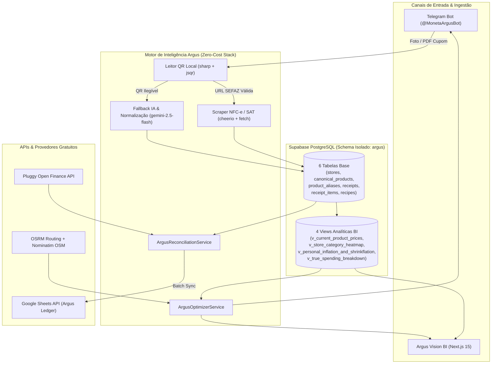

# 🏛️ Arquitetura Técnica — Argus (`moneta-argus`)

## 1. Isolamento em relação ao `MonetaSync`

O projeto **Argus (`moneta-argus`)** foi desenhado como um sistema independente que compartilha a filosofia de engenharia do `MonetaSync` (validação fail-safe com Zod, logs estruturados Pino com redaction de segredos, adapters desacoplados para Pluggy e Google Sheets), mas opera com **isolamento estrito de dados**:
- **Banco de Dados (Schema `argus`):** Enquanto o `MonetaSync` utiliza o schema `public` (`Account`, `Transaction`), o **Argus** armazena todas as suas tabelas e views exclusivamente no schema `argus` (`migrations/001_init_argus_schema.sql`).
- **Planilha Google (`Argus - Controle de Mercado & Receitas`):** Sincronizada em lote via `batchUpdate` em 4 abas dedicadas (`Transacoes_OpenFinance`, `Historico_Itens`, `Comparativo_Mercados`, `Receitas_Custos`), além de manter espelho local auditável em `data/argus-ledger-mirror.json`.

---

## 2. Diagrama de Arquitetura e Fluxo de Dados

---

## 3. Modelagem Relacional e Fórmulas de BI (`migrations/001_init_argus_schema.sql`)

### 3.1. Normalização por Unidade Base (`g`, `ml`, `un`)
Todo item de cupom fiscal passa pelo cache `argus.product_aliases` e é vinculado a um `argus.canonical_products`. O preço pago é convertido para `normalized_price_per_base_unit`:
- Alimentos sólidos e carnes → preço por **grama (`g`)**.
- Líquidos, bebidas e combustíveis → preço por **mililitro (`ml`)**.
- Itens unitários (ovos, rolos) → preço por **unidade (`un`)**.

### 3.2. Decaimento Temporal de Preços (`argus.v_current_product_prices`)
Para evitar distorções de promoções antigas sem perder a memória de preço de cada mercado, o preço estimado atual aplica:
$$\text{Preço Estimado} = 0.70 \times P_{\text{último}} + 0.30 \times \left(\frac{P_{t-1} + P_{t-2} + P_{t-3}}{3}\right)$$

### 3.3. Detector de Reduflação (`argus.v_personal_inflation_and_shrinkflation`)
Compara `last_seen_package_size` registrado nos aliases com o `standard_package_size` do produto canônico. Se `last_seen_package_size < standard_package_size` e o preço por unidade base (`g`/`ml`) subiu ou permaneceu estável, a flag `shrinkflation_detected = TRUE` é acionada junto com o percentual de redução da embalagem (`package_reduction_pct`).

### 3.4. Simulador Logístico (Carro vs. Uber) e Trava `MIN_SAVINGS_HURDLE`
O `ArgusOptimizerService` consulta o motor público do **OSRM** (`router.project-osrm.org/route/v1/driving/...`) para obter a distância real em quilômetros e o tempo em minutos de duas topologias:
1. **Mercado Único:** $\text{Casa} \rightarrow M_1 \rightarrow \text{Casa}$
2. **Compra Dividida (Arbitragem):** $\text{Casa} \rightarrow M_1 \rightarrow M_2 \rightarrow \text{Casa}$

- **Custo Gasolina:** $\left(\frac{\text{Distância Total km}}{\text{CAR\_KM\_PER\_LITER}}\right) \times \text{Preço Litro Gasolina}$
- **Custo Uber (por trecho):** $\max\left(\text{UBER\_MIN\_TRIP\_FARE},\; \text{UBER\_BASE\_FARE} + \text{km} \times \text{UBER\_RATE\_PER\_KM} + \text{min} \times \text{UBER\_RATE\_PER\_MIN}\right)$
- **Trava de Decisão (`MIN_SAVINGS_HURDLE = R$ 25,00`):** O Argus só recomenda dividir a compra em dois mercados se a economia líquida (descontando o deslocamento extra) superar R$ 25,00.

---

## 4. Segurança e Privacidade

- Nenhum segredo (`TELEGRAM_BOT_TOKEN`, `GEMINI_API_KEY`, `SUPABASE_SERVICE_ROLE_KEY`, `PLUGGY_CLIENT_SECRET`, `GOOGLE_PRIVATE_KEY`, `DATABASE_URL`) é versionado no Git.
- O arquivo `.gitignore` bloqueia `.env`, `.env.local` e espelhos de dados sensíveis (`data/*.json`).
- O logger estruturado (`src/config/logger.ts`) censura automaticamente qualquer propriedade sensível com `[REDACTED_BY_ARGUS]`.
