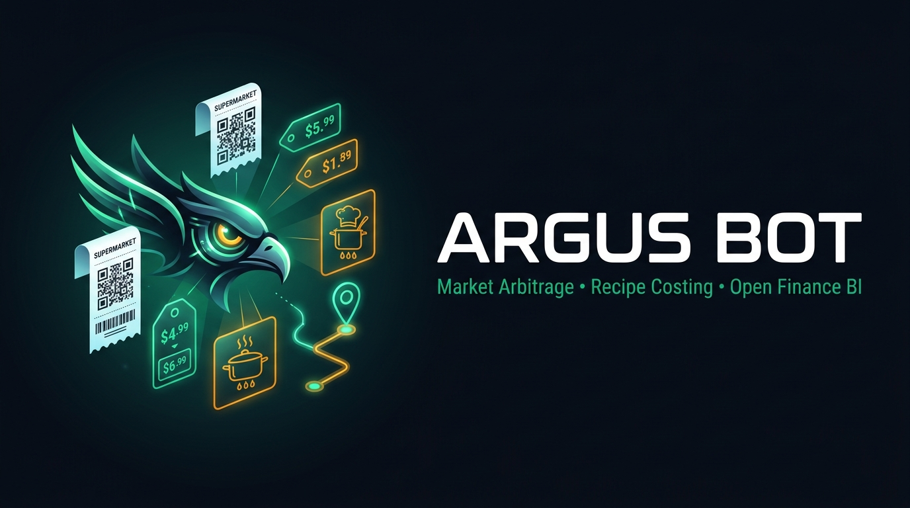
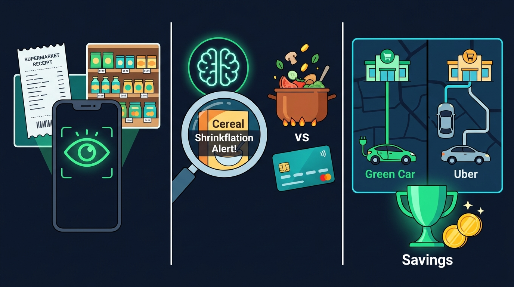
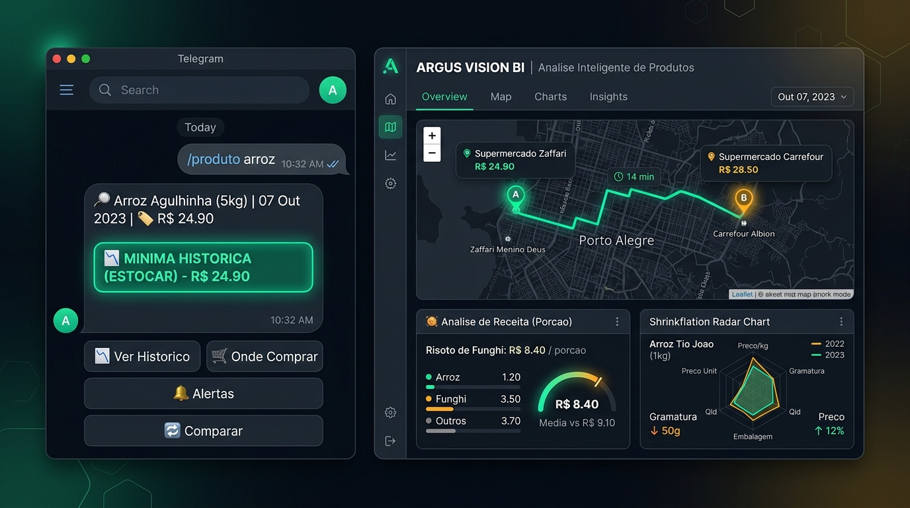
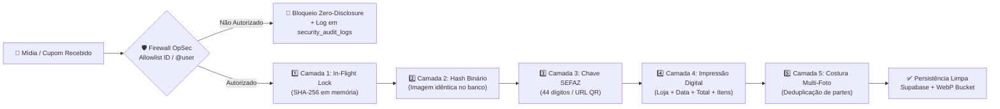

<a name="top"></a>

<div align="center">

[](https://lucasdlg5.github.io/ArgusBot/)

[](https://nextjs.org/)
[](https://react.dev/)
[](https://www.typescriptlang.org/)
[](services/receipt-vision-api)
[](src/bot/index.ts)
[](#%EF%B8%8F-como-instalar-e-rodar-localmente)
[](ARCHITECTURE.md)
[-10B981?logo=shield&logoColor=white)](#-seguran%C3%A7a-auditoria-e-5-camadas-anti-duplicidade)
[](ARCHITECTURE.md)
[](ARCHITECTURE.md)
[](https://github.com/lucasdlg5/ArgusBot/actions/workflows/deploy-github-pages.yml)
[](https://github.com/lucasdlg5/ArgusBot/actions/workflows/hourly-media-queue-worker.yml)
[-22C55E?logo=vitest&logoColor=white)](#-testes-e-qualidade)
[](src/config/version.ts)
[](https://github.com/lucasdlg5/ArgusBot/commits/main)
[](https://lucasdlg5.github.io/ArgusBot/)
[](LICENSE)

⭐ **Curtiu o projeto? Deixe uma Star no GitHub — seu apoio motiva muito a evolução do Argus!** 🙏😊

[](https://x.com/intent/tweet?text=Conhe%C3%A7a%20o%20ArgusBot%20%E2%80%94%20O%20Olho%20Fiscal%20no%20Telegram%20com%20BI%20de%20Supermercado%2C%20Receitas%20e%20Open%20Finance:%20https://github.com/lucasdlg5/ArgusBot)
[](https://t.me/share/url?url=https://github.com/lucasdlg5/ArgusBot&text=Olha%20esse%20bot%20de%20supermercado%2C%20receitas%20e%20Open%20Finance%20no%20GitHub!)
[](https://www.linkedin.com/sharing/share-offsite/?url=https://github.com/lucasdlg5/ArgusBot)
[](https://www.reddit.com/submit?title=ArgusBot%20%E2%80%94%20Market%20Arbitrage%2C%20Recipe%20Costing%20%26%20Open%20Finance%20BI&url=https://github.com/lucasdlg5/ArgusBot)
[](https://api.whatsapp.com/send?text=Conhe%C3%A7a%20o%20ArgusBot:%20https://github.com/lucasdlg5/ArgusBot)

<br />

**[🌐 Abrir Painel Argus Vision BI](https://lucasdlg5.github.io/ArgusBot/)** • **[🤖 Comandos do Bot](#-comandos-do-bot-monetaargusbot)** • **[🎬 Como Funciona](#-a-jornada-de-um-cupom-em-3-atos-como-funciona)** • **[🏛️ Arquitetura Técnica](ARCHITECTURE.md)** • **[⚡ Instalação Rápida](#%EF%B8%8F-como-instalar-e-rodar-localmente)**

</div>

---

O **Argus (`@MonetaArgusBot`)** é o **"Olho Fiscal"** do ecossistema **Moneta**: um assistente inteligente de Telegram combinado com um painel executivo de Business Intelligence (**Argus Vision BI**) que transforma fotos de cupons fiscais, vídeos de corredores de supermercado, panfletos de ofertas e receitas culinárias em **decisões reais de economia no bolso**.

📑 Para mergulhar nos detalhes de engenharia, banco de dados e fluxos internos, consulte também a nossa **[Documentação de Arquitetura (`ARCHITECTURE.md`)](ARCHITECTURE.md)**.

---

## 🧭 Sumário (Table of Contents)

- [🎬 A Jornada de um Cupom em 3 Atos (Como Funciona)](#-a-jornada-de-um-cupom-em-3-atos-como-funciona)
- [📡 Status dos Módulos & Pipelines (Command vs. Query Stack)](#-status-dos-m%C3%B3dulos--pipelines-command-vs-query-stack)
- [✨ Por que o Argus é diferente? (Superpoderes)](#-por-que-o-argus-%C3%A9-diferente-superpoderes)
- [💬 Conversando sem Decorar Comandos (Zero-Jargon UX)](#-conversando-sem-decorar-comandos-zero-jargon-ux)
- [🤖 Comandos do Bot (`@MonetaArgusBot`)](#-comandos-do-bot-monetaargusbot)
- [🖥️ Painel Web: Argus Vision BI](#%EF%B8%8F-painel-web-argus-vision-bi)
- [🛡️ Segurança, Auditoria e 5 Camadas Anti-Duplicidade](#%EF%B8%8F-seguran%C3%A7a-auditoria-e-5-camadas-anti-duplicidade)
- [💸 Stack 100% Gratuita (Zero-Cost Stack)](#-stack-100-gratuita-zero-cost-stack)
- [⚙️ Como Instalar e Rodar Localmente](#%EF%B8%8F-como-instalar-e-rodar-localmente)
- [🧪 Testes e Qualidade](#-testes-e-qualidade)
- [🤝 Contribuições e Licença](#-contribui%C3%A7%C3%B5es-e-licen%C3%A7a)

---

## 🎬 A Jornada de um Cupom em 3 Atos (Como Funciona)

Esqueça as planilhas manuais onde você digita item por item no domingo à noite. Com o **Argus**, o trabalho pesado acontece nos bastidores de forma lúdica, rápida e visual:

<div align="center">



</div>

1. **📸 Ato 1 — Você fotografa, grava ou conversa:**  
   Tirou foto de uma nota fiscal amassada? Gravou um vídeo rápido andando pelo corredor do mercado? Viu uma receita deliciosa na internet? Basta jogar no chat do Telegram.
2. **🧠 Ato 2 — O "Olho Fiscal" disseca cada centavo e cada grama:**  
   O Argus decodifica o QR Code da SEFAZ (ou aciona visão computacional multi-LLM), converte tudo para a mesma unidade base (`R$/g`, `R$/ml`, `R$/un`) e **dedura na hora se uma marca diminuiu o pacote na surdina (*Reduflação / Shrinkflation*)**.
3. **🏆 Ato 3 — Veredito na ponta do lápis (Carro vs. Uber & Receitas):**  
   Antes de sair de casa, o Argus calcula o custo real por porção da sua receita, ordena as paradas para **proteger os alimentos gelados/perecíveis por último** e traça a rota real nas ruas (via OSRM) para dizer se vale a pena dividir a compra em dois mercados ou ir em um só — já descontando a gasolina ou o Uber!

---

## 📡 Status dos Módulos & Pipelines (Command vs. Query Stack)

Inspirado em arquiteturas reativas de alta confiabilidade, o Argus separa a **Ingestão & Processamento (Command Stack)** da **Leitura Analítica & BI (Query Stack)**:

<div align="center">

| Domínio / Serviço | Command Stack (Ingestão & Escrita) | Query Stack (Views BI & Leitura) |
| :--- | :---: | :---: |
| **🧾 Receipt Fiscal Engine** *(NFC-e / SAT / QR / OCR)* |  |  |
| **🎥 Price Scanner & Media Queue** *(Gôndolas / Vídeos / Flyers)* |  |  |
| **🍲 Recipe & Cold-Chain Lab** *(Custo por Porção & Perecíveis)* |  |  |
| **🚗 OSRM Logistics Optimizer** *(Carro vs. Uber + Hurdle R$ 25)* |  |  |
| **🏦 Open Finance & Ledger** *(Pluggy API + Google Sheets)* |  |  |
| **🛡️ OpSec & Intrusion Guard** *(Allowlist + Threat Audit)* |  |  |

</div>

---

## ✨ Por que o Argus é diferente? (Superpoderes)

<div align="center">



</div>

### 1. 🕵️‍♂️ Detetive de Reduflação (*Shrinkflation Radar*)
Sabe quando a barra de chocolate passa de `90g` para `80g` pelo mesmo preço? O Argus normaliza cada produto pela sua unidade base (`g`, `ml`, `un`) e cruza o histórico de embalagens na view `argus.v_personal_inflation_and_shrinkflation`. Se o peso encolher e o custo por grama subir, ele dispara um alerta vermelho na hora.

### 2. 🍲 Engenharia de Receitas: Custo por Porção vs. Desembolso no Caixa
Quando você quer cozinhar um prato (ex.: *Strogonoff* ou *Risoto*), você precisa saber duas coisas bem diferentes:
- **💰 Custo por Porção (Uso Proporcional):** Quanto custam exatamente as `300g` de arroz e `200ml` de creme de leite que entram na panela?
- **🛒 Desembolso no Caixa (Embalagem Fechada):** Quanto você vai pagar no caixa do mercado tendo que levar o pacote fechado de `1kg` ou `5kg` (e quanto sobra na sua despensa para as próximas receitas)?
- **🧊 Ordem Anti-Perecíveis (*Cold-Chain Protection*):** Se a compra for dividida em 2 mercados, o Argus manda você passar **primeiro** onde estão os secos/limpeza e **por último** onde estão carnes, laticínios e congelados, mantendo os itens refrigerados protegidos pelo menor tempo possível fora da geladeira.

### 3. 🚗 Simulador Logístico Real: Gasolina vs. Uber (Trava de R$ 25,00)
Economizar R$ 8,00 nos produtos atravessando a cidade para gastar R$ 15,00 de gasolina e 45 minutos no trânsito é prejuízo disfarçado. O Argus consulta a malha viária real no **OSRM (`router.project-osrm.org`)**, desconta o combustível (ou as corridas de Uber) e aplica a trava `MIN_SAVINGS_HURDLE = R$ 25,00`: **ele só recomenda dividir a compra em dois mercados se o lucro líquido final superar a trava!**

### 4. 📸 Visão Computacional Híbrida + Fila Resiliente
- **Notas longas em 2 ou 3 fotos?** O pipeline em Python (`receipt-vision-api`) e o processador TypeScript costuram verticalmente (*Receipt Stitching*) múltiplas partes do mesmo cupom sem duplicar itens.
- **Sinal do mercado oscilou ou a IA demorou?** Nenhuma foto ou vídeo é perdido: a mídia vai para o bucket `FotosArgus` (convertida para WebP leve) e entra na fila `argus.media_processing_queue`, sendo reprocessada automaticamente de hora em hora com notificação direta respondendo à foto original!

---

## 💬 Conversando sem Decorar Comandos (Zero-Jargon UX)

Você pode interagir com o `@MonetaArgusBot` exatamente como conversaria com um amigo no Telegram:

| O que você envia no chat | O que o Argus faz automaticamente |
| :--- | :--- |
| 💬 **"Quanto tá o arroz?"** ou **"Onde o café tá mais barato?"** | Entende a pergunta em linguagem natural, busca no catálogo e já mostra os preços e botões rápidos. |
| 📸 **Foto ou PDF de Cupom Fiscal (1 ou várias partes)** | Passa pelas 5 camadas anti-duplicidade, lê o QR Code ou OCR via IA, mostra os itens e pede confirmação com 1 toque. |
| 🔗 **Link da SEFAZ** | Raspa a nota fiscal diretamente no portal da Secretaria da Fazenda e salva todos os produtos. |
| 🎥 **Vídeo do corredor / Foto de gôndola ou encarte** | Extrai dezenas de preços da prateleira, calcula a **% de Confiabilidade** da leitura e salva no histórico. |
| 🍳 **Texto, Foto/Print ou Link de site de Receita** | Importa a receita (TudoGostoso, Panelinha, foto de caderno ou texto livre), cadastra os ingredientes e calcula onde comprar mais barato. |

---

## 🤖 Comandos do Bot (`@MonetaArgusBot`)

Se preferir ir direto ao ponto, todos os comandos contam com botões interativos (*Inline Keyboards*) e figurinhas de reação:

### 🔍 1. Preços, Produtos e Coletas em Loja
| Comando | Exemplo Prático | O que ele entrega |
| :--- | :--- | :--- |
| **`/produto <item>`** *(ou `/preco`)* | `/produto arroz` | Lista o preço estimado atual em cada mercado (70% último preço + 30% média anterior), o valor por `g`/`ml`/`un` e destaca **`🔥 MÍNIMA HISTÓRICA (ESTOCAR)`**. |
| **`/loja <Mercado \| Bairro>`** | `/loja Atacadão \| Paulista` | Vincula ou corrige o nome do mercado e filial da última coleta de vídeo/gôndola, recalculando e elevando o score de confiabilidade do lote. |
| **`/fila`** | `/fila` | Exibe o painel de controle da fila de mídias (`SUCCEEDED`, `QUEUED_RETRY`, `FAILED_PERMANENT`), os últimos preços coletados e botão para forçar reprocessamento imediato. |

### 🍲 2. Receitas, Despensa e Rotas de Compra
| Comando | Exemplo Prático | O que ele entrega |
| :--- | :--- | :--- |
| **`/receita [nome]`** | `/receita strogonoff` | Mostra o **Custo por Porção**, **Custo Proporcional da Receita**, **Desembolso de Caixa**, aproveitamento de despensa, **Ordem Anti-Perecíveis** e receitas similares que reaproveitam ingredientes. |
| **`/otimizar`** | `/otimizar` | Executa o Simulador Logístico OSRM comparando **Mercado Único vs. Compra Dividida** e **Carro (Gasolina) vs. Uber**, com veredito final auditado pela trava de R$ 25,00. |

### 📊 3. Finanças, BI e Segurança
| Comando | Exemplo Prático | O que ele entrega |
| :--- | :--- | :--- |
| **`/dashboard`** | `/dashboard` | Envia um Resumo Executivo direto no Telegram (gastos por pilar no mês, alertas de reduflação e top ofertas) + botão para abrir o **Argus Vision BI** na web. |
| **`/reconciliar`** | `/reconciliar` | Cruza os cupons fiscais com as transações bancárias do **Pluggy Open Finance** (janela `-2h` a `+48h`, tolerância `<= R$ 0,05`), separa carteira `VR_VA` e sincroniza a planilha **Argus Ledger** no Google Sheets. |
| **`/seguranca`** | `/seguranca` | Relatório completo de tentativas de acesso bloqueadas, classificação de ameaças (`LOW`, `MEDIUM`, `HIGH`, `CRITICAL`) e log de intrusos em `argus.security_audit_logs`. |
| **`/start`** / **`/ajuda`** | `/start` | Apresenta o menu principal do Olho Fiscal com atalhos clicáveis para todas as funções. |

---

## 🖥️ Painel Web: Argus Vision BI

Além do bot no Telegram, o repositório inclui uma aplicação web completa em **Next.js 15 + React 19 + Tailwind CSS** (hospedada gratuitamente no GitHub Pages com sincronização em tempo real via Supabase):

- 📊 **Visão Geral (`/`)**: KPIs executivos, radar de Reduflação, desconstrução real de gastos (*Alimentação Essencial* vs. *Limpeza* vs. *Impulso/Besteiras*), Heatmap de preços por corredor e Simulador Logístico com mapa interativo **Leaflet Dark Matter**.
- 🧾 **Auditoria de Notas (`/notas`)**: Galeria de cupons fiscais com fotos originais comprimidas em WebP, itens extraídos, edição assistida de loja (`ArgusStoreCombobox`) e reprocessamento via IA.
- 📦 **Catálogo de Produtos (`/produtos`)**: Busca instantânea com paginação inteligente, histórico de preços por marca e mercado, e indicadores de frescor da informação (`< 15 dias`, `15-30 dias`, `> 30 dias`).
- 🏪 **Comparativo de Mercados (`/mercados`)**: Ranking de competitividade entre supermercados e atacadistas locais.
- 🍲 **Laboratório de Receitas (`/receitas`)**: Cards comparativos com destaque para **Custo por Porção**, guia interativo do que você já tem na despensa (`RecipePantryGuideChat`) e roteiro de compras anti-perecíveis.

---

## 🛡️ Segurança, Auditoria e 5 Camadas Anti-Duplicidade



---

## 💸 Stack 100% Gratuita (Zero-Cost Stack)

| Camada | Tecnologia / Provedor | Papel no Ecossistema Argus |
| :--- | :--- | :--- |
| **Frontend & Dashboard BI** | **Next.js 15 (App Router)** + **React 19** + **Tailwind CSS** | Interface executiva Dark Mode (`Slate` / `Emerald` / `Amber`) e exportação estática para GitHub Pages |
| **Mapas & Roteirização** | **Leaflet / React-Leaflet** + **OSRM** + **Nominatim** | Mapa interativo e cálculo de rotas viárias reais (`km`, `min` e geometria GeoJSON) a custo zero |
| **Bot do Telegram** | **`grammY` (TypeScript)** | Servidor do `@MonetaArgusBot` com suporte a álbuns de fotos, vídeos, documentos, links e Inline Keyboards |
| **Visão Computacional & IA** | **Gemini 2.5 Flash** + **FastAPI / OpenCV (`receipt-vision-api`)** + **`sharp` / `jsqr`** | Decodificação local de QR Code, costura vertical de cupons longos, OCR de notas amassadas e vídeos de gôndola |
| **Banco de Dados & Storage** | **Supabase PostgreSQL** + **Supabase Storage (`FotosArgus`)** | Schema isolado `argus` (tabelas transacionais + 4 Views Analíticas de BI) e armazenamento de imagens em WebP |
| **Open Finance & Planilha** | **Pluggy SDK** + **Google Sheets API (`googleapis`)** | Conciliação bancária automática e sincronização em lote na planilha *Argus Ledger* |

---

## ⚙️ Como Instalar e Rodar Localmente

<details open>
<summary><b>🚀 Passo a Passo Rápido (Node.js 20.11+)</b></summary>

### 1. Clonar e instalar dependências
```bash
git clone https://github.com/lucasdlg5/ArgusBot.git
cd ArgusBot
npm install --legacy-peer-deps
```

### 2. Configurar variáveis de ambiente (`.env`)
```bash
cp .env.example .env
```
Preencha no arquivo `.env`:
- `DATABASE_URL` / `DIRECT_URL` e `SUPABASE_URL` / `SUPABASE_SERVICE_ROLE_KEY`: Conexão com seu banco e Storage no Supabase.
- `TELEGRAM_BOT_TOKEN`: Token gerado no `@BotFather` + `TELEGRAM_ALLOWED_USER_IDS` para blindar o acesso ao seu ID.
- `GEMINI_API_KEY`: Chave gratuita do Google AI Studio (`gemini-2.5-flash`).
- `HOME_LAT`, `HOME_LNG`, `HOME_ADDRESS`: Coordenadas de partida para o Simulador Logístico OSRM.
- *(Opcional)* Credenciais `PLUGGY_*` (Open Finance) e `GOOGLE_*` (planilha Google Sheets).

### 3. Diagnosticar ambiente e criar tabelas no banco
```bash
# Valida as chaves do .env e testa conectividade com Supabase, Gemini, Telegram, Sheets e OSRM
npm run setup:env

# Aplica as migrations SQL no schema isolado `argus`
npm run db:migrate
```

### 4. Iniciar o Bot e o Painel Web
```bash
# Iniciar o @MonetaArgusBot em modo desenvolvimento (hot-reload)
npm run bot:dev

# Em outro terminal, iniciar o painel web Argus Vision BI (http://localhost:3000)
npm run dev
```

</details>

<details>
<summary><b>🐳 Opcional: Subir o Microsserviço Python de Visão Computacional (<code>receipt-vision-api</code>)</b></summary>

Para pré-processamento avançado com OpenCV, costura de múltiplas fotos (*stitching*) e extração de frames de vídeos de corredor:

```bash
cd services/receipt-vision-api
pip install -r requirements.txt
uvicorn app.main:app --host 0.0.0.0 --port 8000
```

</details>

---

## 🧪 Testes e Qualidade

O projeto mantém tipagem estrita em TypeScript e suíte de testes automatizados com **Vitest** cobrindo normalização de lojas/marcas, conversação natural, cálculo de receitas, cadeia fria, datas fiscais e otimizador logístico:

```bash
# Verificação estrita de tipos TypeScript (zero erros)
npm run typecheck

# Execução da suíte de testes automatizados (Vitest)
npm test
```

---

## 🤝 Contribuições e Licença

Encontrou algum cupom fiscal exótico, tem sugestões de novas análises de BI ou melhorias para o algoritmo de rotas e receitas?
- Abra uma **[Issue](https://github.com/lucasdlg5/ArgusBot/issues)** relatando o fluxo ou sugestão.
- Envie um **[Pull Request](https://github.com/lucasdlg5/ArgusBot/pulls)** seguindo o padrão de commits semânticos do repositório.

Distribuído sob a licença **MIT**.

<div align="right">
  <a href="#top">⬆️ Voltar ao topo</a>
</div>
